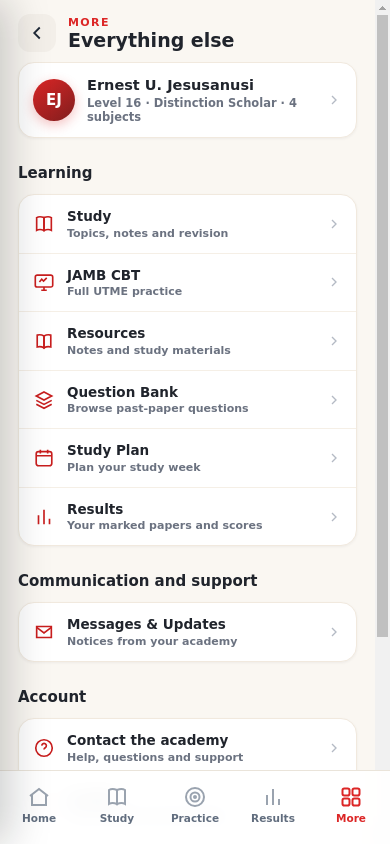
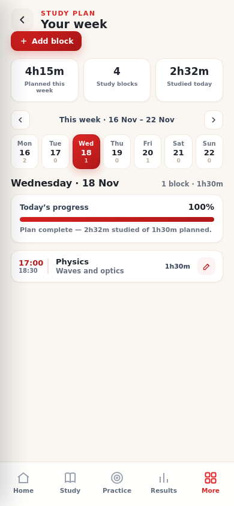
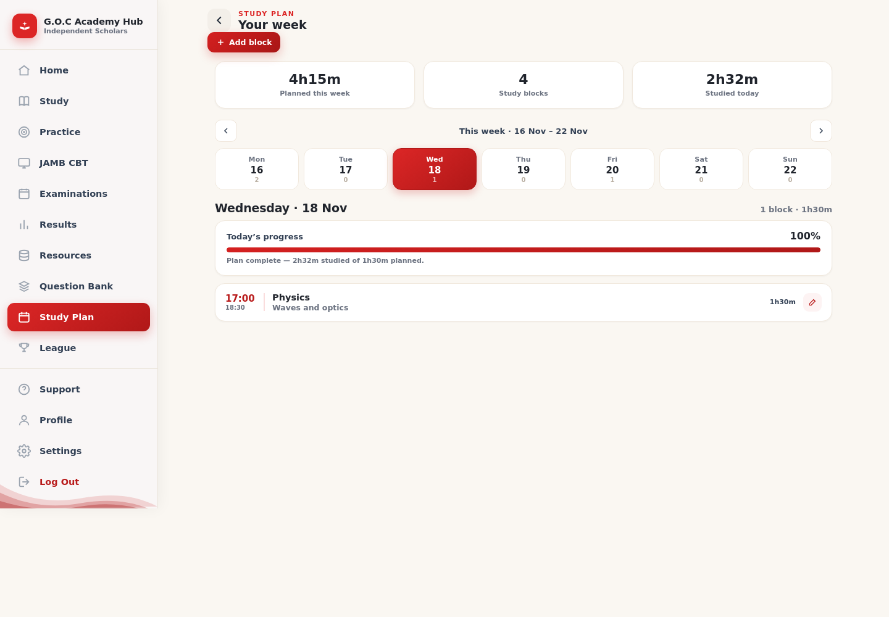
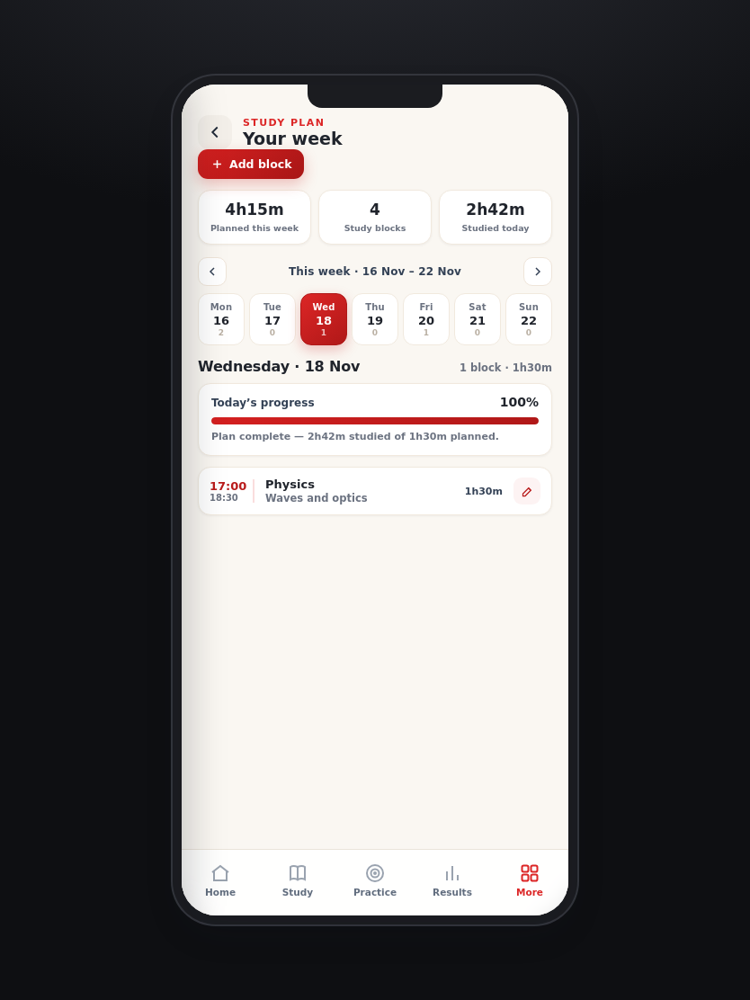
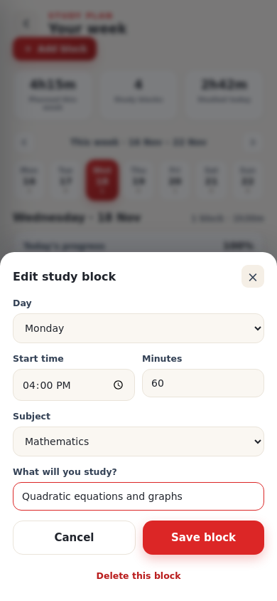
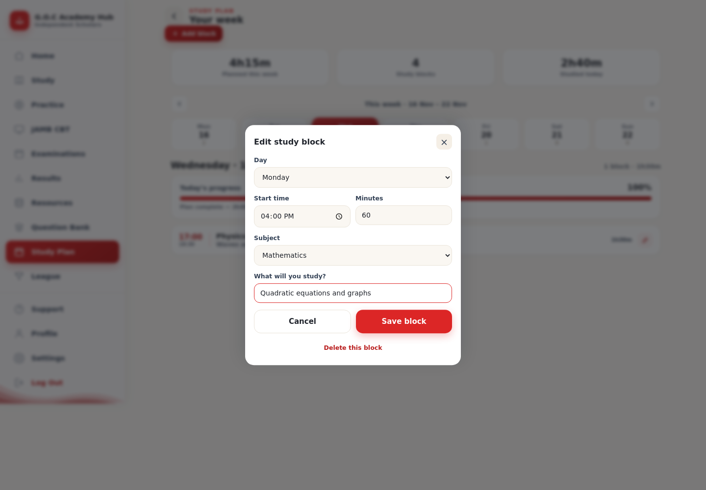
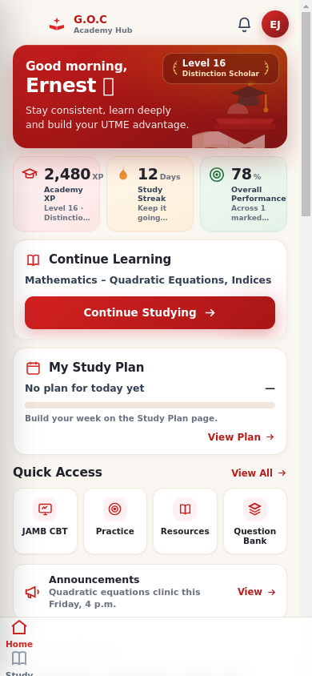
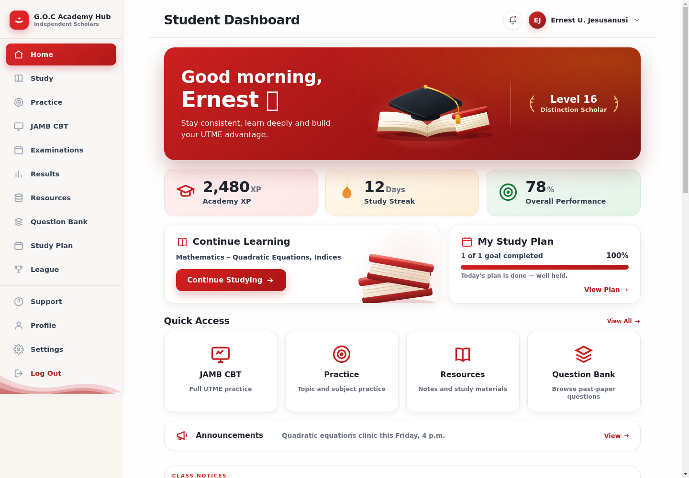
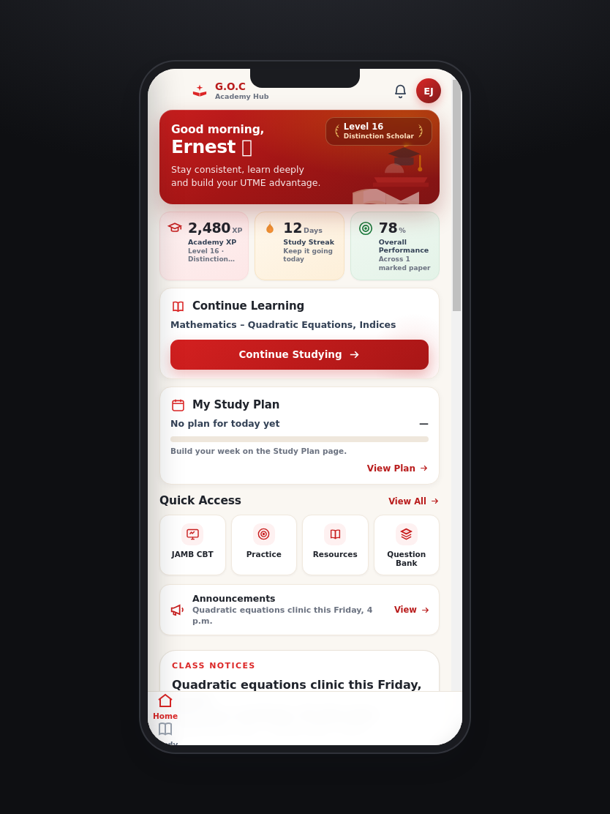

# A01 — Round 8: the More hub, and a Study Plan worth the name

**Commit** `65751b8` · pushed to `arena/1f98403a-goc-academy-hub`
(`655a4e7..65751b8`) · **not merged, not deployed.**

---

## 1. What this round was asked to fix

Two things were wrong and one thing did not exist:

1. **More opened Profile.** It was a shortcut wearing the name of a menu.
2. **Study Plan redirected to Classes.** There was no screen of its own, and no
   way to save a plan anywhere — the planner engine existed, the persistence
   did not.
3. **Quick Access was short of the ~148px target** (130px on a phone).

The Product Owner separately approved the one piece of backend this needed:
`GET /api/me/plan`, `PUT /api/me/plan`, and a `planBlocks` field on the
authenticated student's own record. Nothing beyond that was built.

---

## 2. Changed files

| File | What changed |
|---|---|
| `index.html` | New `#more` hub (10 rows) and new `#studyplan` screen (stats, week strip, week navigation, day panel, progress, block list, empty state, error state, add/edit sheet). More tab → `go('more')`; sidebar Study Plan row → `dashPlanGo()`. |
| `js/goc-core.js` | New saved-plan payload layer before the `videoFeature` comment: `planClockMinutes`, `planEndLabel`, `planBlockOverlaps`, `planValidateStoredBlock`, `planValidatePayload`, `planBlocksForDay`, `planTotals` + limits, and 11 exports. |
| `server/server.js` | `GET`/`PUT /api/me/plan`; `studentPlanOf()`, `planResponseFor()`; `planBlocks` added to both record mappers (Appwrite and local). |
| `js/api.js` | `getPlan`/`savePlan` on the demo driver, the server driver and the public surface; `planResponseForLocal()`. |
| `js/app.js` | `paintMoreHub()`; the full Study Plan controller (`spLoad`…`spWrite`) with week navigation; `dashPlanGo()` → `go('studyplan')`; `go()` wiring for `more`/`studyplan`; dashboard plan card loads the saved plan on first paint; drawer `aria-expanded` for both hamburgers; `paintMoreHub` no longer references an undefined `studentName`. |
| `css/styles.css` | MORE hub block and STUDY PLAN block (mobile + `min-width:900px`); Quick Access to 148px; editor overlay fixed to the viewport; notch clearance for the framed layout. |
| `test/test-study-plan-api.js` | **New.** 64 checks over real HTTP. |
| `test/test-more-hub.js` | **New.** 101 checks in minidom. |
| `test/test-home-dashboard.js` | 5 assertions updated from the retired Classes mapping; 2 added for the plan card's first paint. **67/0.** |
| `test/run.js` | Registers both new suites. |
| `docs/*.png` | 9 screenshots (3 dashboard, 4 Study Plan, 1 More, plus the editor). |

---

## 3. The More hub

Ten rows, in the approved order and groups, each calling a handler the desktop
sidebar already calls:

**Learning** — Study → `go('study')` · JAMB CBT → `dashJambGo()` · Resources →
`go('resources')` · Question Bank → `openPastQuestions()` · Study Plan →
`dashPlanGo()` · Results → `openResults()`
**Communication and support** — Messages & Updates → `go('updates')` · Contact
the academy → `dashSupportGo()`
**Account** — Profile → `go('profile')` · Settings → `go('profile')`

Verified absent from the whole screen: Scholarships, any inbox, any private
messaging, any video destination, any timetable entry point.

Above 900px the screen is not a reachable destination: the More tab is already
hidden there, and `go('more')` now lands on the dashboard rather than drawing a
phone menu over the desktop layout.



---

## 4. The Study Plan screen

Its own destination — not Classes, not a rebuild of the retired standalone
Timetable. What it does:

- **Weekly view** — the seven days, Monday first (the engine's own order), each
  with its real date and its block count.
- **Week navigation** — ‹ › walk the calendar a week at a time, and the label
  reads `This week · 16 Nov – 22 Nov`. The saved plan is a *weekly* timetable,
  which is the engine's model, so the arrows move the week you are looking at,
  not the plan. "Today" is only marked in the current week.
- **Day selection** — tapping a day shows that day's blocks and its total.
- **Add / edit / delete** — one sheet serves both; delete asks for confirmation
  and says it cannot be undone.
- **Validation** — the sheet validates with `GOC.core.planValidateStoredBlock`
  and refuses with the engine's own wording ("That time is already taken on
  Thursday.") before anything is sent.
- **Planned time** — daily total beside the day name, weekly total in the stats.
- **Real progress** — measured against `state.used`, the study time the server
  already records. Progress is only claimed **for today**; for any other day the
  panel states what is planned and says progress is tracked on the day itself,
  rather than inventing a studied figure.
- **Empty and error states** — an empty day names the day and offers a way to
  fill it; a failed read says so and offers Try again.







---

## 5. API summary

| | |
|---|---|
| `GET /api/me/plan` | `need: 'student'` |
| `PUT /api/me/plan` | `need: 'student'`, body `{ blocks: [...] }` |

**Response — identical shape for GET, PUT, empty and populated:**

```json
{ "ok": true,
  "blocks": [ { "id": "b1", "day": "Mon", "start": "16:00", "minutes": 60,
                "end": "17:00", "subject": "Mathematics",
                "topic": "Quadratic equations and graphs", "kind": "study" } ],
  "totals": { "perDay": { "Mon": 60, "Tue": 0, "…": 0 },
              "weekMinutes": 150, "count": 2 },
  "savedAt": "2026-11-18T09:14:22.104Z" }
```

`end` is **derived** from `start + minutes` on every read and is never stored.

**Stored schema** — one attribute on the student's own record:

```
planBlocks = JSON string "{ blocks: [ … ], savedAt: ISO }"
block = { id, day, start, minutes, subject, topic }
```

**Validation rules** (enforced server-side, on the whole payload):

| Rule | Limit |
|---|---|
| Blocks per plan | ≤ 80 |
| `id` | 1–40 chars `[A-Za-z0-9_-]`, unique within the plan |
| `day` | one of `Mon Tue Wed Thu Fri Sat Sun` |
| `start` | `HH:MM`, 24-hour, 00:00–23:59 |
| `minutes` | 5–240 |
| `subject` | one of the student's own papers, or a shared planner slot |
| `topic` | 1–120 characters, not blank |
| overlap | no two blocks on the same day may overlap (back-to-back is fine) |

**Authority** — the student is always `sess.data.id`. No field in the payload is
read as an identifier, so a payload naming somebody else is ignored rather than
honoured (proven in the tests).

**Persistence** — Appwrite mode patches only `planBlocks` via
`updateAppwriteStudent`; local mode sets it on the already-read record and calls
`writeData`. Legacy records without the field read as an empty plan and are
**not** written to; a hand-corrupted value reads as an empty plan and the student
can save over it. No localStorage anywhere.

---

## 6. Test results

### New: `test/test-study-plan-api.js` — 64 checks, 0 failures

Real HTTP against a real server on a temp data dir, two students, a restart and
a hand-edited record. Covers: GET with no plan; GET after save; PUT create; PUT
update (replaces, does not merge); 16 rejection cases (bad day, bad time, 3-min
and 400-min blocks, foreign subject, blank topic, missing ID, path characters in
an ID, duplicate IDs, overlapping blocks, non-list payload, over the cap) with
the stored plan proven byte-identical afterwards; empty plan; back-to-back
blocks allowed; unauthenticated GET and PUT refused; cross-student read and
overwrite refused; other record fields (identity, XP, streak, tier, goal,
subjects, `studySecToday`) unchanged; **plan survives a server restart from the
same data dir**; a legacy record without `planBlocks` reads empty, is not
migrated, and keeps the rest of its record intact; a corrupted value degrades to
an empty plan and can be saved over.

### New: `test/test-more-hub.js` — 101 checks, 0 failures

The ten rows and their exact targets; no Scholarships / inbox / messaging /
video / timetable text; More does not show Profile; Messages & Updates opens
`updates`; Contact the academy opens the landing support section; `go('more')`
lands on the dashboard at desktop width; drawer opens and closes; five primary
tabs with More fifth; no non-primary More row. Study Plan: every part present;
`dashPlanGo()` reaches `studyplan`; the sidebar row reaches it too; honest empty
state; seven days with real dates; week navigation moves dates by exactly seven
days and marks no other week as today; the engine's validator refuses an
overlapping block with its own wording; add; edit keeping the ID; delete asking
first and honouring a decline; nothing in localStorage; no duplicated engine.

### Regression

`test/test-home-dashboard.js` **67 / 0**.
`node test/run.js` → **203 passed, 4 failed**.

```
FAILED  test-backup-integrity.js
FAILED  test-free2027-local.js
FAILED  test-migration-api-config.js
FAILED  test-production-persistence.js
```

**Not a clean suite.** These four are the documented baseline failures. I
re-ran all four against the base commit in a worktree and all four exit `1`
there too — the failure *set* is unchanged, and no new failure was introduced.

Browser checks against the live server (`GOC_DATA_DIR=/tmp/gocshot`, port 8099):
41/41 on the interaction suite (dashboard card → Study Plan, day selection, week
navigation, add, edit, delete with a declined and an accepted confirmation,
persistence after reload, More → Updates, More → Support, More ≠ Profile, five
tabs, drawer).

---

## 7. Persistence confirmed

- **Survives reload** — after adding, editing and deleting blocks, a full page
  reload reads the same plan back from the server.
- **Survives restart** — the API suite kills the server, boots a fresh one on the
  same data directory, and reads the saved block back. (The *session* ends on
  restart by design; the student signs in again and the **plan** is what
  survives, which is what the test asserts.)
- **Authoritative store** — the server's record. The client holds only the last
  response, and a failed save leaves the list on screen unchanged.

---

## 8. Existing data intact

A plan write touches `planBlocks` and nothing else. The API suite asserts
identity, XP, streak, tier, goal, subjects and `studySecToday` are unchanged
across a write, and that a legacy record gains no field from being read.
`server/data.json` is not committed. Results, attempts, practice history,
question-bank data, classes, auth and permissions are untouched. No video
interfaces were added; no excluded feature returned.

---

## 9. Quick Access

Now **148px** on a phone and on a tablet (was 130px), **170px** on desktop
(unchanged). The height came from padding and the icon, not the type: title,
subtitle and Question Bank's two-line wrap are exactly as they were.





---

## 10. Things fixed that were not on the list

Each surfaced while proving the two corrections, so leaving them would have
meant shipping a test that passes around a known defect.

1. **The dashboard's plan card lied on first paint.** It showed "No plan for
   today yet" to a student who had one, and only told the truth after the Study
   Plan page had been opened once. It now reads the plan in its own load chain.
2. **The dashboard hamburger never reported its state.** `openDrawer()` updated
   only the landing page's burger, so the dashboard's button kept saying
   `aria-expanded="false"` while the menu was open.
3. **`paintMoreHub` referenced an undefined `studentName`** — it only survived
   because `dashMe` happened to be populated.
4. **The Results row sat outside its list** — a stray `</div>` broke the markup,
   so Communication and Account rendered without their cards.
5. **The desktop editor dialog was not centred** — a later
   `#spEditor.show .sp-sheet{transform:translateY(0)}` cancelled the centring
   translate. The sheet is now position-only and the overlay owns visibility.
6. **The phone frame's notch cut through every screen's header** at tablet
   widths — not just the new screen. Fixed at the frame level.
7. **`test/test-home-dashboard.js` was already broken at `655a4e7`** — it threw
   on load because `go()` calls `getComputedStyle` and the harness has no style
   engine. Guarded, so the suite runs again.

---

## 11. Limitations

- **Visual approval is not claimed.** These screens have not been reviewed
  against the mockup by anyone but me. The red-and-white language, the card
  styling and the spacing follow the approved system, but that is my judgement,
  not a sign-off.
- **The plan is a recurring weekly timetable, not dated entries.** That is the
  planner engine's model and I kept it rather than inventing a second one. So
  week navigation changes the dates you are looking at, not what is planned.
  If dated, per-week plans are wanted, that is a schema decision beyond this
  round's approval.
- **Progress is a today figure.** The app records study time per day; it does
  not keep a per-block or per-day history, so past days cannot show how much was
  actually studied. The panel says so rather than guessing.
- **Settings has no screen of its own.** `#settings` does not exist; the Settings
  row opens Profile, which is where password and account controls live. That is
  the existing behaviour, unchanged.
- **The four baseline failures remain.** They fail identically on the base
  commit; I did not investigate or fix them in this round.
- **Tablet is a framed phone layout**, per the existing architecture. The screen
  is correct there, but it is the phone composition inside the device frame, not
  a distinct tablet design.
- The capture account in `/tmp/gocshot` had its password reset to take the
  screenshots. That is a scratch data directory, not the repository's data file.
